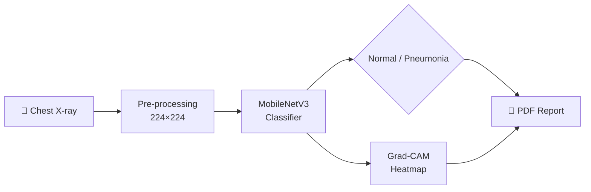

<div align="center">


<br><br>

[](https://pneumoscan-ai-shodo.streamlit.app/)
[](https://www.python.org/)
[](https://pytorch.org/)
[](https://streamlit.io/)

</div>

---

## 🇸🇦 نظرة عامة

**PneumoScan AI** تطبيق ويب متكامل للكشف عن الالتهاب الرئوي من صور الأشعة السينية للصدر. يعتمد على نموذج تعلّم عميق (**MobileNetV3**) مبني بواسطة **PyTorch** ومدرَّب بأسلوب *Transfer Learning*، ويقدّم واجهة تفاعلية حديثة باللغتين العربية والإنجليزية.

الميزة الأهم أن النظام لا يعطيك نتيجة فقط، بل **يشرح قراره** عبر خريطة حرارية (Grad-CAM) تُظهر المناطق التي ركّز عليها النموذج، مما يرفع الثقة في النتيجة ويسهّل مراجعتها.

## 🇬🇧 Overview

**PneumoScan AI** is a full web application that detects pneumonia from chest X-ray images. It runs a **MobileNetV3** classifier built with **PyTorch** and fine-tuned with transfer learning, wrapped in a modern, interactive **Streamlit** interface available in both Arabic and English.

Beyond a label and a confidence score, PneumoScan **explains its decision**: a Grad-CAM heatmap highlights the lung regions that influenced the prediction, making the output easier to review and trust.

---

## ✨ Features

<table>
  <tr>
    <td width="50%" valign="top">
      <h3>🧠 Explainable AI · تفسير القرار</h3>
      <p>Grad-CAM heatmaps show which regions drove the prediction.<br>
      <sub>خريطة حرارية توضح المناطق التي اعتمد عليها النموذج.</sub></p>
    </td>
    <td width="50%" valign="top">
      <h3>⚡ Instant Diagnosis · تشخيص فوري</h3>
      <p>Normal / Pneumonia classification with a confidence score.<br>
      <sub>تصنيف الصورة مع نسبة الثقة في أقل من ثانية.</sub></p>
    </td>
  </tr>
  <tr>
    <td width="50%" valign="top">
      <h3>📄 Clinical PDF Reports · تقارير طبية</h3>
      <p>Export a report with patient data, the original X-ray, and the heatmap.<br>
      <sub>تقرير PDF يضم بيانات المريض والصورة والخريطة الحرارية.</sub></p>
    </td>
    <td width="50%" valign="top">
      <h3>🎲 Demo Mode · تجربة سريعة</h3>
      <p>Load a random sample X-ray in one click, no upload required.<br>
      <sub>حمّل صورة أشعة عشوائية بضغطة واحدة بدون رفع ملف.</sub></p>
    </td>
  </tr>
</table>

---

## 📸 App Preview

<div align="center">
  <!-- ضع رابط صورتك هنا بدلاً من هذا النص -->
  
</div>

---

## 🔬 How It Works



---

## 🛠️ Tech Stack

<div align="center">

| Layer | Technologies |
| :--- | :--- |
| **Deep Learning** | `PyTorch` · `Torchvision` · `MobileNetV3` (transfer learning) |
| **Explainable AI** | `pytorch-grad-cam` (Grad-CAM) |
| **Web App & UI** | `Python 3.11` · `Streamlit` · custom CSS / SVG |
| **Image Processing** | `Pillow` · `NumPy` · `OpenCV` |
| **Reporting** | `ReportLab` |

</div>

---

## 📂 Project Structure & Live Demo

```text
PneumoScanAI/
├── app.py                    # Streamlit app (UI, inference, Grad-CAM, PDF)
├── pneumonia_mobilenet.pth   # Trained model weights
├── requirements.txt          # Python dependencies
└── README.md
```

👉 **تجربة التطبيق مباشرة | Try the App Now:** 
[**انقر هنا لتجربة الموقع (Click Here)**](https://pneumoscan-ai-shodo.streamlit.app/)

---

## 🚀 Getting Started

**Prerequisites:** Python 3.11+ and `pip`. A GPU is optional.

**1. Clone the repository**
```bash
git clone https://github.com/Shahad58/PneumoScanAI.git
cd PneumoScanAI
```

**2. Install dependencies**
```bash
pip install -r requirements.txt
```

**3. Add model weights**
Ensure `pneumonia_mobilenet.pth` is in the project root.

**4. Run the app**
```bash
streamlit run app.py
```

---

## ⚠️ Disclaimer

> **EN:** PneumoScan AI is built for **educational purposes only**. It is not a medical device and must not replace diagnosis by a qualified radiologist.
>
> **AR:** هذا المشروع مخصص **للأغراض التعليمية فقط**، وليس جهازاً طبياً، ولا يغني عن تشخيص طبيب مختص.

---

<div align="center">

## 👨‍💻 Author

**SHODO** ⛥

[](https://github.com/Shahad58)


</div>
