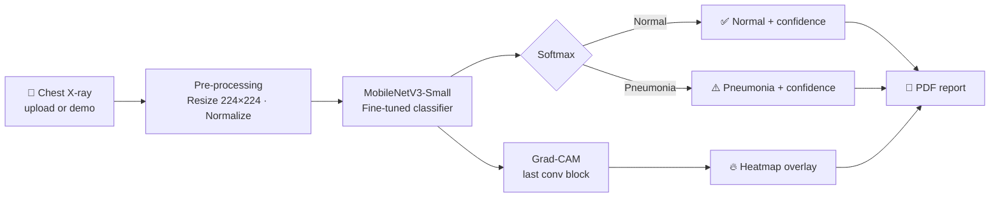

<div align="center">


<br><br>

[](https://pneumoscan-ai-shodo.streamlit.app/)
[](https://www.python.org/)
[](https://pytorch.org/)
[](https://streamlit.io/)


[**العربية**](#-نظرة-عامة) · [**English**](#-overview) · [**Architecture**](#-how-it-works) · [**Run locally**](#-getting-started) · [**Author**](#-author)

</div>

---

## 📑 Table of Contents

- [نظرة عامة](#-نظرة-عامة)
- [Overview](#-overview)
- [Features](#-features)
- [App Preview](#-app-preview)
- [How It Works](#-how-it-works)
- [Tech Stack](#-tech-stack)
- [Project Structure](#-project-structure)
- [Getting Started](#-getting-started)
- [Usage Guide](#-usage-guide)
- [Model Details](#-model-details)
- [Roadmap](#-roadmap)
- [Disclaimer](#-disclaimer)
- [Author](#-author)

---

## 🇸🇦 نظرة عامة

<div dir="rtl">

**PneumoScan AI** تطبيق ويب متكامل للكشف عن الالتهاب الرئوي من صور الأشعة السينية للصدر. يعتمد على نموذج تعلّم عميق (**MobileNetV3**) مبني بواسطة **PyTorch** ومدرَّب بأسلوب *Transfer Learning*، ويقدّم واجهة تفاعلية حديثة باللغتين العربية والإنجليزية.

الميزة الأهم أن النظام لا يعطيك نتيجة فقط، بل **يشرح قراره** عبر خريطة حرارية (Grad-CAM) تُظهر المناطق التي ركّز عليها النموذج، مما يرفع الثقة في النتيجة ويسهّل مراجعتها.

</div>

## 🇬🇧 Overview

**PneumoScan AI** is a full web application that detects pneumonia from chest X-ray images. It runs a **MobileNetV3** classifier built with **PyTorch** and fine-tuned with transfer learning, wrapped in a modern, interactive **Streamlit** interface available in both Arabic and English.

Beyond a label and a confidence score, PneumoScan **explains its decision**: a Grad-CAM heatmap highlights the lung regions that influenced the prediction, making the output easier to review and trust.

---

## ✨ Features

<table>
  <tr>
    <td width="50%" valign="top">
      <h3>🧠 Explainable AI · تفسير القرار</h3>
      <p>Grad-CAM heatmaps show which regions drove the prediction.<br>
      <sub>خريطة حرارية توضح المناطق التي اعتمد عليها النموذج.</sub></p>
    </td>
    <td width="50%" valign="top">
      <h3>⚡ Instant Diagnosis · تشخيص فوري</h3>
      <p>Normal / Pneumonia classification with a confidence score, in about a second on CPU.<br>
      <sub>تصنيف الصورة مع نسبة الثقة في أقل من ثانية تقريباً.</sub></p>
    </td>
  </tr>
  <tr>
    <td width="50%" valign="top">
      <h3>📄 Clinical PDF Reports · تقارير طبية</h3>
      <p>Export a report with patient data, the original X-ray, the heatmap and the final result.<br>
      <sub>تقرير PDF يضم بيانات المريض والصورة والخريطة الحرارية والنتيجة.</sub></p>
    </td>
    <td width="50%" valign="top">
      <h3>🎲 Demo Mode · تجربة سريعة</h3>
      <p>Load a random sample X-ray in one click, no upload required.<br>
      <sub>حمّل صورة أشعة عشوائية بضغطة واحدة بدون رفع ملف.</sub></p>
    </td>
  </tr>
  <tr>
    <td width="50%" valign="top">
      <h3>🌐 Bilingual UI · واجهة ثنائية اللغة</h3>
      <p>Switch between Arabic (RTL) and English (LTR) instantly.<br>
      <sub>تبديل فوري بين العربية والإنجليزية مع دعم الاتجاه.</sub></p>
    </td>
    <td width="50%" valign="top">
      <h3>🎨 Animated Interface · واجهة متحركة</h3>
      <p>Animated logo, ECG line, scanning X-ray frame and a live confidence ring.<br>
      <sub>شعار متحرك، خط نبض، إطار مسح للأشعة، وحلقة ثقة تفاعلية.</sub></p>
    </td>
  </tr>
</table>

---

## 📸 App Preview

<div align="center">

<!-- Replace each placeholder with your own screenshot, e.g. docs/home.png -->


<br><br>

<table>
  <tr>
    <td width="50%"></td>
    <td width="50%"></td>
  </tr>
  <tr>
    <td align="center"><sub>Diagnosis &amp; confidence ring</sub></td>
    <td align="center"><sub>Grad-CAM focus area</sub></td>
  </tr>
</table>

</div>

---

## 🔬 How It Works



1. **Input:** the user uploads a JPG/PNG X-ray or loads a demo case.
2. **Pre-processing:** the image is resized to 224×224 and normalized with ImageNet statistics.
3. **Inference:** MobileNetV3 outputs class probabilities; the highest becomes the diagnosis and its probability the confidence score.
4. **Explainability:** Grad-CAM is computed on the final convolutional block for the predicted class and overlaid on the X-ray.
5. **Report:** results, patient details and both images are exported as a PDF.

> If the weights file is missing, the app falls back to a clearly labelled **simulation mode** so the interface can still be demonstrated.

---

## 🛠️ Tech Stack

<div align="center">

| Layer | Technologies |
| :--- | :--- |
| **Deep Learning** | `PyTorch` · `Torchvision` · `MobileNetV3` (transfer learning) |
| **Explainable AI** | `pytorch-grad-cam` (Grad-CAM) |
| **Web App & UI** | `Python 3.11` · `Streamlit` · custom CSS / SVG animations |
| **Image Processing** | `Pillow` · `NumPy` · `OpenCV` |
| **Reporting** | `ReportLab` |

</div>

---

## 📂 Project Structure

```text
PneumoScanAI/
├── app.py                    # Streamlit app (UI, inference, Grad-CAM, PDF)
├── pneumonia_mobilenet.pth   # Trained model weights
├── requirements.txt          # Python dependencies
├── chest_xray/               # (optional) dataset folder for local demo cases
│   └── test/
│       ├── NORMAL/
│       └── PNEUMONIA/
└── README.md
```

---

## 🚀 Getting Started

**Prerequisites:** Python 3.11+ and `pip`. A GPU is optional; the app runs fine on CPU.

**1. Clone the repository**

```bash
git clone https://github.com/Shahad58/PneumoScanAI.git
cd PneumoScanAI
```

**2. (Recommended) Create a virtual environment**

```bash
python -m venv .venv
source .venv/bin/activate        # Windows: .venv\Scripts\activate
```

**3. Install dependencies**

```bash
pip install -r requirements.txt
```

<details>
<summary>📦 Core packages (if you need to install manually)</summary>

```bash
pip install streamlit torch torchvision pillow numpy grad-cam reportlab
```

</details>

**4. Add the model weights**

Place `pneumonia_mobilenet.pth` in the project root next to `app.py`.

**5. (Optional) Enable local demo cases**

Put a `chest_xray/` folder next to `app.py` with `test/NORMAL` and `test/PNEUMONIA` sub-folders, such as the public *Chest X-Ray Images (Pneumonia)* dataset.

**6. Run**

```bash
streamlit run app.py
```

Open the URL shown in the terminal (usually `http://localhost:8501`).

---

## 🧭 Usage Guide

| Step | Action |
| :---: | :--- |
| **1** | Enter the doctor name, patient name and ID (optional, used in the PDF). |
| **2** | Upload an X-ray or press **Try a Demo Case**. |
| **3** | Press **Run AI Analysis**. |
| **4** | Review the diagnosis, confidence ring and Grad-CAM heatmap. |
| **5** | Download the **Clinical PDF Report** or start a **New Analysis**. |

---

## 🧪 Model Details

| Property | Value |
| :--- | :--- |
| Architecture | MobileNetV3-Small with a 2-class output head |
| Classes | `NORMAL`, `PNEUMONIA` |
| Input size | 224 × 224 RGB |
| Normalization | ImageNet mean / std |
| Explainability | Grad-CAM on the last feature block |

### 📈 Performance

> Fill this table with your own evaluation results on the held-out test set.

| Metric | Score |
| :--- | :---: |
| Accuracy | _xx.x %_ |
| Precision | _xx.x %_ |
| Recall (Sensitivity) | _xx.x %_ |
| F1-Score | _xx.x %_ |

---

## 🗺️ Roadmap

- [x] MobileNetV3 pneumonia classifier
- [x] Grad-CAM explainability
- [x] Arabic / English interface
- [x] PDF clinical report
- [x] Animated, redesigned UI
- [ ] Multi-class support (bacterial vs. viral pneumonia)
- [ ] Batch analysis of multiple X-rays
- [ ] Arabic text in PDF reports
- [ ] Model comparison (e.g. EfficientNet, DenseNet)
- [ ] Docker image for one-command deployment

---

## ⚠️ Disclaimer

> **EN:** PneumoScan AI is built for **educational and demonstration purposes only**. It is not a medical device and must not be used as a substitute for diagnosis by a qualified radiologist or physician.
>
> **AR:** هذا المشروع مخصص **للأغراض التعليمية والعرض التوضيحي فقط**، وليس جهازاً طبياً، ولا يغني أبداً عن تشخيص طبيب أشعة أو طبيب مختص.

---

<div align="center">

## 👨‍💻 Author

**SHODO** ⛥

[](https://github.com/Shahad58)

<sub>If you found this project useful, consider giving it a ⭐</sub>


</div>
